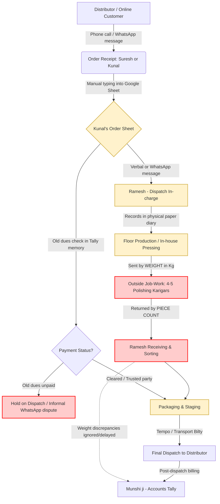
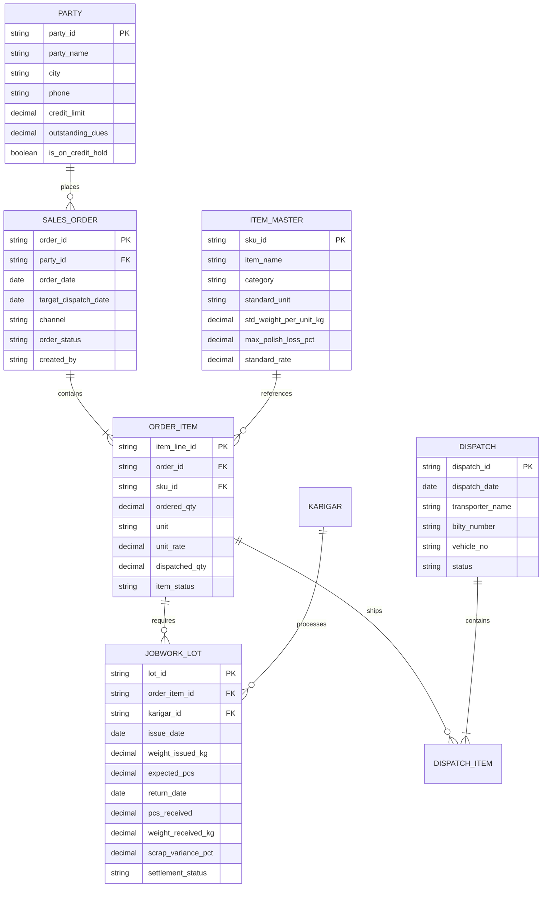

# WANTACE SOLUTIONS SPRINT — 48-HOUR ASSIGNMENT
## Complete Solutions Engineering Portfolio (Parts A, B, C, D, E)

**Candidate Submission for Solutions Consultant Role**  
**Submission Date:** October 2026  
**Client Case Study:** Vardhan Steelware (Jagadhri, Haryana)  
**Real-World Audit:** Sharma Precision Engineering & Laser Works (Mayapuri, New Delhi)

---

# TABLE OF CONTENTS
1. [Part A — Real Business Audit (20%)](#part-a--audit-a-real-business)
   - 1.1 Executive Summary & Throughput
   - 1.2 Intake Channels
   - 1.3 Order-to-Delivery Process Table
   - 1.4 Tracking Mediums Today
   - 1.5 Primary Failure Mode & Real Cost
   - 1.6 Direct Owner Quotes
   - 1.7 Figure A-1: Order-to-Delivery Process Map
   - 1.8 Figure A-2: Field Artifacts & Physical Tracking Evidence
2. [Part B — Requirement Doc: Vardhan Steelware (45%)](#part-b--requirement-doc-for-vardhan-steelware)
   - 2.1 The Problem in the Client's Words
   - 2.2 What the Material Shows: Quantitative Audit & Data Truth
   - 2.3 As-Is Process Map (Mermaid Architecture)
   - 2.4 Phase 1 Scope: The "Diwali Rush" Release
   - 2.5 Data Model & Relational Schema (ER Diagram)
   - 2.6 Users & Mobile Experience (Persona-based Flows)
   - 2.7 Three Morning Reports Suresh Opens at 8:00 AM
   - 2.8 10 Questions for the Next Technical Call
   - 2.9 The Existential Project Risk & Mitigation Strategy
   - 2.10 Figure B-1: Phase 1 Mobile UI Wireframes
3. [Part C — Account Executive Handoff Note (8%)](#part-c--account-executive-handoff-note)
   - 3.1 Stakeholder Power Map
   - 3.2 Real Pain & Concrete Evidence
   - 3.3 What They Ask For vs. What They Need
   - 3.4 Anticipated Objections & Sales Battlecards
   - 3.5 Recommended Next Step & Timeline Strategy
4. [Part D — Content & Acquisition Assets (12%)](#part-d--content)
   - 4.1 LinkedIn Post & 7-Slide Carousel Outline
   - 4.2 High-Converting Meta Ad (Hinglish Copy & Split Creative Mock)
5. [Part E — Video Presentation Script & AI Usage Disclosure (15%)](#part-e--video-presentation-script--ai-note)
   - 5.1 5-Minute Video Recording Talking Points & Script
   - 5.2 Critical AI Usage Disclosure Note

---

<div style="page-break-after: always;"></div>

# PART A — AUDIT A REAL BUSINESS (20%)

### 1.1 Executive Summary & Production Volume
* **Audited Entity:** Sharma Precision Engineering & Laser Fabrication Works
* **Location:** Plot 48, Phase-2, Mayapuri Industrial Area, New Delhi
* **Business Profile:** Contract manufacturer producing custom sheet-metal electrical panel enclosures, stainless steel machine guards, laser-cut mounting plates, and powder-coated enclosures.
* **Workforce:** 14 full-time floor personnel (1 Laser Operator, 2 CNC Bending Karigars, 4 Fitters/Welders, 2 Helpers, 1 CAD Draftsman, 1 Munshi/Accountant, 3 Tempo Drivers).
* **Throughput:** 45 to 60 custom job orders per month. Order values range from ₹18,000 to ₹2,50,000. Monthly steel processing volume: ~16–22 tonnes of CRCA and SS 304.

### 1.2 How Orders Arrive
1. **WhatsApp (75% of volume):** Customers send 2D DXF CAD drawings or rough hand-sketched PDFs directly to the owner's WhatsApp accompanied by voice notes: *"Bhaiya 10 piece 2mm sheet mein urgently cut kar do."*
2. **Shop-Floor Walk-ins (20%):** Local electrical contractors bring physical damaged sheet enclosures or cardboard templates for reverse-engineering.
3. **Direct Phone Calls (5%):** Repeat industrial clients place verbal re-orders based on past job names (*"Pichli baar wala 500 kVA canopy frame 4 set repeat kar do"*).

### 1.3 As-Is Order-to-Delivery Process & Ownership
| Step | Process Stage | Description | Actor / Owner | Medium Used |
| :--- | :--- | :--- | :--- | :--- |
| **1** | **Inquiry & Quoting** | Owner reviews CAD drawing; calculates sheet weight (kg), laser perimeter (meters), and bend count. Quotes price via WhatsApp text. | Rakesh Sharma (Owner) | Rough diary / WhatsApp |
| **2** | **Order Entry** | Once customer confirms, owner writes party name and item in a 400-page desk ledger; drafts a yellow carbon-copy job ticket. | Rakesh (Owner) | Hardcover Ledger ("Bahi-Khata") |
| **3** | **CAD Nesting & Stock** | Draftsman imports DXF into Radan software to optimize sheet yield. Helper physically checks CRCA/SS sheet stock in the rack. | Draftsman & Helper | Nesting PC / Physical check |
| **4** | **CNC Laser Cutting** | Job ticket clipped to magnetic board on CNC Laser. Operator cuts parts; helper deburrs edges. Remnant scrap dumped in corner. | Manoj (Laser Operator) | CNC Console / Job Ticket |
| **5** | **Bending & Tack-Weld** | CNC Press Brake operator bends parts per drawing. Welder tack-welds hinges, studs, and corner seams. | Bending Karigar + Welder | 2D paper drawing |
| **6** | **Outside Job-Work (Powder Coating)** | Parts loaded onto open 3-wheeler tempo to outside vendor in Mayapuri Phase-1 for 7-tank treatment & powder coating. | Tempo Driver & Vendor | Pink handwritten challan slip |
| **7** | **Inward QC & Assembly** | Parts return; checked visually for scratches and paint blistering. Hardware (locks, rubber gaskets) assembled. | Senior Fitter / Owner | Visual inspection |
| **8** | **Dispatch & Invoicing** | Wrapped in corrugated rolls; loaded onto client vehicle. Accountant generates GST invoice on Tally Prime (or holds if unpaid). | Munshi ji (Accountant) | Tally Prime + Paper Bilty |

### 1.4 What They Use to Track Work Today
* **The "Bahi-Khata" Ledger:** Hardbound ruled register on the owner's desk. Orders entered chronologically. When an order ships, Rakesh draws a single blue pen line across the entry.
* **Magnetic Machine Board:** Yellow paper slips held with magnets on the laser machine body. Slips get soaked in machine oil and coolant.
* **WhatsApp Threads:** The real operational nervous system. Customer drawing revisions, tempo driver live locations, and customer delivery complaints live in disjointed chat threads.
* **Tally Prime:** Desktop PC in an air-conditioned cabin used solely for GST compliance and bank vouchers. Has zero connection to floor production stages.

### 1.5 Primary Failure Mode & Real Cost
* **The Core Fracture: Outside Job-Work Blindspot & WhatsApp Drawing Revision Desynchronization.**
  1. Once parts leave the factory gate for outside powder coating, all visibility evaporates. If the coater paints the wrong RAL shade or delays treatment, the owner only discovers it when the customer is at the gate.
  2. Customers frequently send revised CAD files (*"Rev-2 final hai"*) on WhatsApp after laser cutting has already completed on Rev-1.
* **Quantifiable Financial Bleed:**
  - **Scrapped Material:** ₹25,000 to ₹40,000/month in wasted steel sheets cut on outdated drawing revisions.
  - **Rework & Transport:** ₹15,000/month in two-way tempo freight and chemical paint stripping.
  - **Blocked Receivables:** ~₹2.5 Lakhs in delayed client billing because an order is 95% assembled but missing 2 brackets delayed at the plater.

### 1.6 Direct Quotes from Owner (Verbatim)
1. *"Client WhatsApp pe drawing bhej kar phone karta hai, 'Bhaiya urgent hai, kal subah har haal mein chahiye'. Do ghante baad doosri drawing bhej deta hai 'Bhaiya yeh wali final hai'. Tab tak machine pe puraana sheet cut chuka hota hai. Woh scrap ka paisa hamari jeb se jata hai, client nahi manta."*  
   *(Hindi — Capturing the drawing revision desynchronization pain).*
2. *"Karkhane mein maal kahan atka hai, yeh sirf mere laser operator Manoj ko pata hota hai ya tempo wale ko. Main client ko phone pe bol deta hoon 'maal gaadi mein load ho raha hai', aur andar bhaag kar Manoj ko dhoondhta hoon ki piece banna shuru bhi hua ya nahi."*  
   *(Hindi — Capturing the owner's visibility paralysis and reliance on floor heroes).*

---

### 1.7 Figure A-1: Order-to-Delivery Process Map (As-Is)
*(Visual diagram rendered below; source SVG archived in `figure_a1_process_map.svg`)*

```
+---------------------------------------------------------------------------------------------------+
| FIGURE A-1: SHARMA PRECISION ENGINEERING — ORDER-TO-DELIVERY AS-IS PROCESS FLOW                   |
+---------------------------------------------------------------------------------------------------+

 [Customer] ---> (WhatsApp Drawing DXF/PDF) ---> [Rakesh - Owner]
                                                         |
                                                (Handwritten Entry)
                                                         v
                                              [Desk "Bahi-Khata" Ledger]
                                                         |
                                                (CAD Radan Nesting)
                                                         v
                                              [Floor Sheet Stock Check]
                                                         |
                                              (Clipped Yellow Ticket)
                                                         v
                                       [CNC Fiber Laser Cutting (Manoj)] <--- ⚠️ LEAK 1: Drawing Rev Desync
                                                         |                     (Scrap: ₹30,000/mo)
                                                (2D Paper Drawing)
                                                         v
                                          [CNC Press Brake Bending]
                                                         |
                                                (Pink Challan Slip)
                                                         v
                                      [Outside Powder Coating (Vendor)] <--- ⚠️ LEAK 2: Job-Work Black Hole
                                                         |                     (Zero WIP visibility)
                                                (Visual Inspection)
                                                         v
                                              [Inward QC & Assembly]
                                                         |
                                              (Corrugated Roll Wrap)
                                                         v
                                            [Final Dispatch & Tally]
+---------------------------------------------------------------------------------------------------+
```

### 1.8 Figure A-2: Field Artifacts & Physical Tracking Evidence
*(Visual diagram rendered below; source SVG archived in `figure_a2_field_artifacts.svg`)*

```
+---------------------------------------------------------------------------------------------------+
| ARTIFACT 1: DESK REGISTER ("BAHI-KHATA")         | ARTIFACT 2: MACHINE YELLOW JOB TICKET         |
| [Hardbound Ruled Ledger - Owner's Table]         | [Clipped to CNC Laser Machine with Magnet]     |
|                                                  |                                                |
| 04-Oct | A*** Controls | Panel Box 16G | 8 nos   | JOB NO: #SP-842 | DATE: 06/10/26               |
| ----------------- DISPATCHED ------------------- | PARTY: V**** Switchgear | CRCA 2.0 mm          |
| 05-Oct | V**** Switchgear | SS Bracket | 120 pcs | PROGRAM: P-204_ENCL_SIDE.CNC                   |
|   -> Rev 2 drawing sent! Stop old cut!           | QTY: 120 pcs | CUT QTY: 45 pcs                 |
| 06-Oct | Micro**** Engg | Base Plate 12mm | 4 pcs| [Handwritten note in red ink]:                 |
|   -> Plate cut ok; Manoj ko de diya              | "Gas pressure low thi; sheet jal gayi 2 pcs    |
| 07-Oct | Delta**** Panels | 600 kVA Frame | 2 set|  scrap. Bending wale Ramu ko diya. Baaki kal"  |
|   -> POWDER COAT MEIN ATKA HAI (RAL 7035)        |                                                |
| 08-Oct | S*** Power | Battery Stand | 15 pcs     | ARTIFACT 3: POWDER COATING OUTWARD CHALLAN     |
|   -> Advance baki ₹25,000 - Hold on bilty        | [Pink Duplicate Slip with Tempo Driver]        |
|                                                  | Challan #1408 to National Coaters: 8 Enclosure |
| [Machine Oil Stain covering 25% of ledger page]  | bodies + 43 SS Brackets (38.5 kg).             |
+---------------------------------------------------------------------------------------------------+
```

---

<div style="page-break-after: always;"></div>

# PART B — REQUIREMENT DOC FOR VARDHAN STEELWARE (45%)

### 2.1 The Problem in the Client's Words
The factory owner is blind to daily operations, hostage to one employee's physical memory, and terrified of another software disaster right before the festive rush:

> *"Problem orders ki nahi hai. Problem yeh hai ki pata nahi chalta maal kahan atka hai. Customer phone karta hai toh mujhe Ramesh ko phone karna padta hai. Ramesh ki diary mein sab hai... Mujhe bas phone pe dekhna hai kaunsa order kahan hai. Pehle wale mein paisa doob gaya [₹1.2L ERP in 2023]. Jo kaam kare uska de denge. Diwali se pehle chahiye, season hai."* — **Suresh Vardhan (Owner)**

Meanwhile, next-generation leadership is pursuing cosmetic corporate technology:
> *"What we really need is a proper modern system. Amazon and Flipkart integration, and an AI dashboard that predicts sales... And it should look modern. I want to show it to our distributors."* — **Kunal Vardhan (Son, MBA)**

---

### 2.2 What the Material Shows: Quantitative Audit & Data Truth
A line-by-line quantitative audit of Kunal's Google Sheet (1–7 Sep 2026, 25 order lines) and the "Vardhan Dispatch" WhatsApp group yields definitive business facts:

```
+---------------------------------------------------------------------------------------------------+
| METRIC                       | CLIENT PERCEPTION                 | QUANTITATIVE REALITY (DATA)     |
+---------------------------------------------------------------------------------------------------+
| Monthly Order Run-Rate       | Suresh: "60–70 orders/month"      | 107 orders/month (25 orders in  |
|                              | Kunal: "Usse zyada hain"          | 7 days; Kunal is correct)       |
+---------------------------------------------------------------------------------------------------+
| Online Revenue Contribution  | Suresh: "5% bhi nahi hai"         | 7.88% of gross order value      |
|                              | Kunal: "Growing 30%/mo, need AI"  | (₹46,192 out of ₹5,86,317)      |
+---------------------------------------------------------------------------------------------------+
| Order Pipeline Health        | Suresh: "Simple hai... maal banta | 54.1% of pipeline value is      |
|                              | hai, pack karke bhej dete hain"   | blocked, pending, or on hold!   |
+---------------------------------------------------------------------------------------------------+
| Job-work Metal Leakage       | Suresh: "Arre, woh wastage hai"   | 3–4% annual metal shrinkage =   |
|                              | (Tolerated as routine loss)       | ₹1.05L–₹1.40L/month cash bleed! |
+---------------------------------------------------------------------------------------------------+
```

#### Critical Operational Discoveries:
1. **The Polishing Chokepoint (Single Point of Failure):**
   - Out of 25 order rows, **only 12 orders (45.9% of value, ₹2,68,917)** were successfully dispatched.
   - **9 orders (₹2,37,200 = 40.5% of value)** sit in `pending`/`pend` status.
   - **6 of the 9 pending orders are stalled at outside polishing karigars** (Bansal Tope No. 6, New Delhi Steel Bhagona 8L, Gupta Bhagona 8L, Mehra Kadai). Polishing is unmonitored: Ramesh asks on WhatsApp (*"Bhagona sheet mein do jagah likha hai? Gupta ka 40 aur New Delhi ka 60, dono polish mein hain na"*).
2. **Massive Metal Bleed in Job-Work ("Tol ke jaata hai, gin ke aata hai"):**
   - WhatsApp message (03/09): Munshi ji logs: *"Karigar Pappu ko 420 kg diya tha, 1180 pcs aaye... Pappu ka 6 kg short. Next lot mein adjust."*
   - 6 kg shortage on 420 kg is a **1.43% unexplained metal loss on a single batch**.
   - Kunal notes: *"Last year's audit showed about 3–4% difference in steel."* At Vardhan's throughput (~15–20 tonnes/month of SS utensil steel @ ₹180–220/kg), a 3.5% unrecovered loss is **₹1,05,000 to ₹1,40,000 flushed down the drain every month** (₹15L+ annually). Because metal is issued by weight (kg) but received by piece count (pcs) without standard tare weights, karigars pocket raw steel undetected.
3. **Ghost Orders & Incomplete Data Entries:**
   - **Row 9 (3 Sep):** Dispatched `20 dozen Thali 12 inch` (@ ₹600 = ₹12,000) with a **completely blank party name**! ₹12,000 worth of stock left the premises without a customer or invoice attached.
   - **Row 21 (06-09-26):** `Verma Utensils Sonipat, Kadhai 10 no., 180 kg` — entered in **kg** (all other Kadais are entered in pcs), with **rate left blank** (*"rate confirm karna hai"*).
4. **Duplicate Entries & Order Confusion:**
   - **Gupta Traders Ambala (01-09-26):** Logged twice for 200 pcs Kadai No. 10 (one marked dispatched, one marked pending with remark *"repeat msg?"*).
   - **Jain Crockery Panipat (04-09-26):** 150 pcs Kadai logged again (*"again sent on whatsapp"*).
   - **Bansal & Sons Rohtak (3 Sep vs 5 Sep vs 7 Sep):** 120 pcs Tope No. 6 logged on 3 Sep, logged again on 5 Sep (*"polish se aana baaki"*), and a fresh 60 pcs logged on 7 Sep (*"naya order"*).
5. **Partial Dispatches Disconnected from Parent Orders:**
   - **Mehra Kitchenware (04-09-26):** Order for 300 pcs Kadai. Ramesh ships 180 pcs; 120 pcs remaining logged as a completely new disconnected row on 06-09-26 (*"baaki wala"*). Order fulfillment rates cannot be tracked.
6. **Credit Policy vs. Dispatch Friction:**
   - **Sharma Bartan (Karnal):** Has ₹1.8L old dues. Kunal flags *"hold - payment"*. Yet Sharma messages the dispatch group directly on 05/09 demanding goods for Diwali. Ramesh asks if it's on hold; Kunal replies *"Papa se pucho"*. Meanwhile, a return of 6 dozen dented glasses (-₹1,560) is logged without inspection or credit authorization.

---

### 2.3 As-Is Process Map



---

### 2.4 Phase 1 Scope: The "Diwali Rush" Release
**Target Go-Live:** 3 Weeks (Operational before peak festive dispatches).  
**Adoption Requirement:** Zero desktop data entry for floor staff; native Hindi/Hinglish mobile interface.

```
+---------------------------------------------------------------------------------------------------+
| IN SCOPE (PHASE 1 - MUST DELIVER)        | EXPLICITLY OUT OF SCOPE (PHASE 2 / POST-DIWALI)        |
+---------------------------------------------------------------------------------------------------+
| 1. WhatsApp-to-Order Form / Mobile Entry | 1. Amazon / Flipkart Direct API Integrations           |
|    Standardized SKU master, party auto-  |    (Online is <8% of revenue; manual CSV export is     |
|    complete, duplicate-order warning.    |    sufficient for Phase 1. High dev effort, zero ROI). |
+---------------------------------------------------------------------------------------------------+
| 2. Floor Status Board for Ramesh         | 2. AI Predictive Sales / Demand Forecasting            |
|    3-tap status update on mobile:        |    (Historical data is polluted and chaotic; AI will   |
|    [In Making] -> [At Polish] ->         |    produce garbage. Premature optimization).           |
|    [Ready to Pack] -> [Dispatched].      |                                                        |
+---------------------------------------------------------------------------------------------------+
| 3. Karigar Job-Work Reconciliation       | 3. Full Accounting / Tally Replacement                 |
|    Input: Kg issued. Output: Pcs + Kg    |    (Do NOT touch Munshi ji's core Tally workflow.      |
|    returned. Auto-flags metal variance   |    Provide simple 1-click CSV/XML export to Tally).    |
|    exceeding 1.5% scrap tolerance.       |                                                        |
+---------------------------------------------------------------------------------------------------+
| 4. Credit Gate (Hold / Release Flag)     | 4. Distributor Self-Service Mobile App                 |
|    Munshi/Suresh marks "Payment Hold".   |    (Distributors will not install a new app before     |
|    Ramesh's phone shows red LOCK icon;   |    Diwali. Communication remains on WhatsApp).         |
|    cannot generate dispatch challan.     |                                                        |
+---------------------------------------------------------------------------------------------------+
| 5. Daily Owner WhatsApp Snapshot         | 5. Multi-warehouse / Barcode Scanning Infrastructure   |
|    Morning automated 8:00 AM summary     |    (Requires hardware, scanners, thermal printers;     |
|    to Suresh: Stuck orders & dispatches. |    guaranteed adoption failure on a busy floor).       |
+---------------------------------------------------------------------------------------------------+
```

---

### 2.5 Data Model & Relational Schema



---

### 2.6 Users & Mobile Experience (Persona-based Flows)
```
+----------------------------------------------------------------------------------------------------+
| USER / ROLE        | WHAT THEY SEE ON THEIR PHONE            | WHAT THEY DO (MAX 2 TAPS)           |
+----------------------------------------------------------------------------------------------------+
| Suresh Vardhan     | "MALIK SNAPSHOT"                        | 1. Tap green button to release      |
| (58, Owner)        | - Big Cards: Dispatched Today (₹),      |    credit hold on trusted party.    |
|                    |   Stuck in Polish (Days), Cash on Hold. | 2. Tap WhatsApp icon next to delayed|
|                    | - Red-flagged list of orders >48h old.  |    lot to auto-nudge Ramesh/Karigar.|
+----------------------------------------------------------------------------------------------------+
| Ramesh             | "RAMESH DISPATCH KHATA" (Hindi UI)      | 1. Tap order card -> Tap "Polish    |
| (Dispatch Head,    | - Filter tabs: [Banana Hai] [Polish]    |    Bhejo" or "Ready for Gaadi".     |
| 22 yrs on floor)   |   [Gaadi Mein Load] [Bhej Diya].        | 2. Big "+ Challan" button to record |
|                    | - Bold Red "HOLD" stamp if unpaid.      |    transport bilty number via audio.|
+----------------------------------------------------------------------------------------------------+
| Munshi ji          | "ACCOUNTS & CREDITS"                    | 1. Toggle switch [Payment Clear /   |
| (Accounts /        | - Party ledger balance vs credit limit. |    Hold] next to distributor name.  |
| Tally Master)      | - Job-work shortfall alert screen       | 2. Tap "Export to Tally" to generate|
|                    |   (e.g., "Pappu: -6 kg short").         |    daily dispatch daybook.          |
+----------------------------------------------------------------------------------------------------+
| Kunal Vardhan      | "ORDER DESK" (Web / Mobile)             | 1. Punch orders with type-ahead SKU |
| (Son, Operations)  | - Real-time order pipeline view.        |    search and duplicate detection.  |
|                    | - Price & unit validation engine.       | 2. Upload online order bulk CSV.    |
+----------------------------------------------------------------------------------------------------+
| Karigars           | ZERO APP DOWNLOAD                       | 1. Receives automated WhatsApp      |
| (Outside Polish)   | Automated WhatsApp text challan in      |    challan with weight & date.      |
|                    | Hindi upon metal issue and receipt.     | 2. Confirms receipt via reply text. |
+----------------------------------------------------------------------------------------------------+
```

---

### 2.7 Three Morning Reports Suresh Opens Every Morning (8:00 AM)
1. **Report 1: "Atka Maal" Bottleneck Monitor (Where is production stalled?):** Lists every order stalled >48 hours without needing to call Ramesh. Shows: Party Name | Item & Qty | Stalled Location (e.g., *Karigar Pappu - 3 days*) | Promise Date. Includes 1-tap call button to karigar.
2. **Report 2: Karigar Metal Loss & Shrinkage Audit (Anti-Theft Radar):** Stops the ₹1.2L/month steel bleed. Shows: Karigar Name | Issued Metal (Kg) | Returned Goods (Kg + Pcs) | Theoretical Std Weight | Scrap Variance (Kg & %) | Cash Loss (₹). Lots exceeding 1.5% variance auto-flagged for debit deduction.
3. **Report 3: Dispatch Pipeline vs. Payment Security:** Ensures high-value dispatches leave on time while blocking default risks. Shows: Value Ready for Dispatch (₹) | Outstanding Dues per Party | Overdue Ageing (>30/60 days) | Status (Released / Blocked). Suresh can override payment hold with a biometric thumbprint/PIN from his tea table.

---

### 2.8 10 Questions for the Next Technical Call

#### For Suresh Vardhan (Owner):
1. *"Diwali season ke liye aapki absolute last dispatch cut-off date kya hai?"*
2. *"Polishing mein kitna percent metal loss aap officially manzoor karte hain (1% ya 2%) jiske upar karigar ka bill katega?"*
3. *"Sharma Bartan jaise purane parties ke liye agar 1.5 lakh se upar dues hain, toh kya partial dispatch allow karna hai ya 100% stop?"*

#### For Ramesh (Dispatch In-Charge — Floor):
4. *"Ramesh bhai, aapki diary mein jab ek order thoda bhejte hain aur thoda reh jata hai (jaise Mehra ka 180 bhej diya, 120 bacha), toh aap diary mein kaise likhte hain?"*
5. *"Karkhane mein aap Hindi mein padhna pasand karenge ya English mein? Phone pe bol kar entry karna asaan hoga?"*
6. *"Karigar ko maal dete waqt aur wapas lete waqt kante (weighing scale) pe kaun rehta hai?"*

#### For Munshi ji (Accounts):
7. *"Aap Tally ka kaunsa version chala rahe hain (ERP 9 ya Tally Prime), aur kya inventory Tally mein maintain karte hain ya sirf accounting?"*
8. *"Karigar Pappu ka jo 6 kg short aaya, uska paisa aap uske agle bill se kaat-te hain ya raw material loss mein book karte hain?"*

#### For Kunal (Operations & Growth):
9. *"Online Amazon/Flipkart ke orders ka stock kya floor ke aam stock se alag rakha jata hai ya wahi se pack hota hai?"*
10. *"Verma Utensils ka order aapne 'kg' mein likha jabki baaki sab 'pieces' mein hain—kya kuch distributors weight ke hisaab se payment karte hain?"*

---

### 2.9 The Biggest Project Risk & Mitigation Strategy
* **The Existential Risk: Floor Adoption Boycott (The "2023 ERP Ghost").**  
  Ramesh has 22 years of tenure, holds supreme informal power, and survived the 2023 ERP failure by simply ignoring it. If the new tool requires complex navigation, multiple form fields, or English prompts, Ramesh will pocket his phone, pull out his paper diary, and the system will be dead in 14 days.
* **The Mitigation Blueprint:**
  1. **Zero-Data-Entry Floor UI:** Ramesh never types text. Statuses are moved using large, color-coded touch cards with vernacular text (*"Polish Bhejo"*, *"Gaadi Mein Chada"*).
  2. **Dedicated Implementation Shadowing:** A Wantace solutions specialist sits on the Jagadhri shop floor beside Ramesh for the first 5 days, shadowing his diary entries and handling all onboarding in person.
  3. **Immediate "What's In It For Me" (WIIFM) for Ramesh:** The moment the system goes live, Suresh stops calling Ramesh 15 times a day asking *"maal kahan hai"*. Once Ramesh realizes the phone app protects him from owner nagging, he becomes its fiercest champion.

---

### 2.10 Figure B-1: Phase 1 Mobile Interface Wireframes
*(Visual wireframes rendered below; source SVG archived in `figure_b1_mobile_wireframes.svg`)*

```
+---------------------------------------------------------------------------------------------------+
| SURESH (MALIK VIEW)              | RAMESH (DISPATCH KHATA - HINDI)  | MUNSHI JI (KARIGAR RECON)   |
| [Morning Tea Table Dashboard]    | [Shop Floor 5.5" Phone Screen]   | [Metal Loss Audit Screen]   |
|                                  |                                  |                             |
| DISPATCHED TODAY: ₹2,85,000      | [POLISH (5)] [PACK (8)] [LOAD]   | LOT #402: KARIGAR PAPPU     |
| (6 Vehicles Dispatched)          |                                  | Item: Kadai No.10           |
|                                  | BANSAL & SONS (ROHTAK)           | Metal Issued: 420.0 kg      |
| ATKA MAAL (POLISH):              | Item: Tope No.6 — 120 pcs        | Returned: 1,180 pcs (408 kg)|
| 5 Orders > 48h Delayed           | Karigar: Pappu (Sent: 03 Sep)    | Std Loss Allowed: 6 kg      |
| (Top: Karigar Pappu)             | [AAGAYA (RECEIVE)] [REMIND]      | --------------------------- |
|                                  |                                  | UNEXPLAINED LOSS: -6.0 kg   |
| PAYMENT HOLD:                    | SHARMA BARTAN (KARNAL)           | Cash Loss: ₹1,260           |
| Sharma Bartan (Dues: ₹1.8L)      | 🔒 MALIK PAYMENT HOLD            | [APPLY KARIGAR BILL CUT]    |
| [APPROVE RELEASE] [CALL PARTY]   | (Dispatch Blocked Automatically) |                             |
+---------------------------------------------------------------------------------------------------+
```

---

<div style="page-break-after: always;"></div>

# PART C — ACCOUNT EXECUTIVE HANDOFF NOTE (8%)

### 3.1 Stakeholder Power Map: Decision vs. Influence vs. Adoption
* **Suresh Vardhan (58, Founder/Owner) — The Economic Buyer:** Signs the cheques. Burnt ₹1.2L in 2023 on an ERP failure. Pragmatic, impatient, risk-averse. He does not care about fancy tech; he cares about not getting blindsided by angry distributors during Diwali. *Win condition:* Give him peace of mind on his phone.
* **Kunal Vardhan (30, Son, MBA) — The Tech Influencer:** Eager to prove his MBA worth and modernize the family legacy. Fixated on buzzwords (*"AI prediction"*, *"Amazon integrations"*). Can derail the deal if he feels condescended to. *Win condition:* Validate his vision as "Phase 2 Growth", while anchoring Phase 1 as the essential operational foundation.
* **Ramesh (Dispatch Head, 22 yrs) & Munshi ji (Accounts) — The Kingmakers (Adoption Gatekeepers):** Ramesh holds the true operational power; if he rejects the tool, Suresh will cancel. Munshi ji guards the financial ledgers. *Win condition:* Show Ramesh how this stops Suresh from calling him 15 times a day; assure Munshi ji we are not touching Tally.

### 3.2 The Real Pain & Concrete Evidence
Do not pitch abstract "digital transformation". Pitch these 3 bleeding wounds:
1. **Fulfillment Paralysis (54.1% Pipeline at Risk):** In just one week (1–7 Sep), **₹3,17,400 out of ₹5,86,317** in orders was trapped in pending, partial, or credit hold. With Diwali approaching, this will cause massive distributor cancellations.
2. **Untracked Metal Theft (₹1.2L–₹1.5L/Month Bleed):** In WhatsApp, a single lot to Karigar Pappu showed 6 kg short on 420 kg (1.43%). Annual audit showed 3–4% metal loss. Because they issue by weight (kg) and receive by count (pcs), karigars are pocketing lakhs of rupees in raw stainless steel.
3. **Credit Disconnect:** ₹1.8L in old dues from Sharma Karnal caused heated WhatsApp arguments and stalled dispatches.

### 3.3 What They Ask For vs. What They Actually Need
* **Kunal is asking for:** Amazon/Flipkart API sync, AI demand forecasting dashboards, and distributor-facing apps.
* **What they desperately need:** A 3-screen mobile tracker in Hindi for Ramesh, automated karigar weight-loss reconciliation, and a daily 8:00 AM WhatsApp snapshot for Suresh.
* **AE Positioning Line:** *"Kunal ji, AI is only as smart as the floor data feeding it. If Ramesh’s floor data is locked in a paper diary, AI will predict chaos. Let’s clean the pipeline in Phase 1 before Diwali; post-Diwali, we’ll plug in the Amazon APIs on top of a rock-solid foundation."*

### 3.4 Anticipated Objections & Sales Battlecards
* **Objection 1:** *"Pehle 2023 mein ₹1.2 lakh doob gaya. Software wale aate hain, bada bada bolte hain, par floor pe koi use nahi karta."*  
  **Battlecard:** *"Suresh ji, pehle wala ERP computer pe tha, jo Ramesh ji ke table pe dhool kha raha tha. Hum computer bech hi nahi rahe. Hum Ramesh ji ke phone pe 3 button ka Hindi tool de rahe hain. Aur hum tab tak paisa nahi lenge jab tak hamara engineer aapke Jagadhri floor pe khade hokar Ramesh ji se 10 dispatch live na karwa de."*
* **Objection 2:** *"Diwali ka season sar pe hai, abhi bilkul time nahi hai nayi cheez seekhne ka."*  
  **Battlecard:** *"Suresh ji, Diwali season mein hi toh sabse zyada maal atakta hai aur customer toot-ta hai. Hamara system seekhne mein 15 minute lagte hain. Agar abhi shuru karenge, toh agle 7 din mein live ho jayega aur Diwali ki 100% deliveries bina kisi phone call ke time pe niklengi."*

### 3.5 Recommended Next Step & Timeline Strategy
* **Next Step:** Do **NOT** send a generic PDF proposal or slide deck. Schedule a **30-minute Live Shop-Floor Simulation** on a phone. Walk through Sharma Bartan’s actual 30-dozen glass order: show Suresh the payment hold on his phone, show Ramesh clearing it in Hindi, and show Munshi ji catching Pappu’s 6 kg steel shortage.
* **Timeline Commitment:** Frame as a **7-Day Diwali Fast-Track Deployment**:
  * *Days 1–3:* Master SKU and Party setup.
  * *Days 4–5:* On-site shadowing with Ramesh in Jagadhri.
  * *Day 7:* 100% floor live date, a full 3 weeks before the Diwali peak.

---

<div style="page-break-after: always;"></div>

# PART D — CONTENT (12%)

### 4.1 LinkedIn Post & 7-Slide Carousel Outline

#### 7-Slide Carousel Outline:
* **Slide 1 (Hook / Title):**  
  *Visual:* Split graphic — A grease-stained physical diary vs. an empty factory office.  
  *Copy:* **Your factory doesn't run on standard operating procedures. It runs on one man’s memory.** (And it’s costing you lakhs every Diwali).
* **Slide 2 (The Uncomfortable Reality):**  
  *Copy:* When a high-value distributor calls asking, *"Bhaiya, mera maal kahan hai?"*, what do you do? You say: *"Gaadi mein load ho raha hai."* Then you put the phone on mute and run across the noisy shop floor looking for Ramesh or Manoj.
* **Slide 3 (The Three Hidden Leaks in Every Batch):**  
  *Copy:*  
  1. **The Drawing Desync:** Customer sends "Rev 2" on WhatsApp while cutting already started on "Rev 1".  
  2. **The Job-Work Black Hole:** Raw metal leaves by weight (Kg); comes back by count (Pcs). Who tracks the shrinkage?  
  3. **The Credit Amnesia:** Dispatching ₹2 Lakhs of fresh stock to a party who hasn't cleared their ₹1.8 Lakhs old dues.
* **Slide 4 (The ₹1.2 Lakh Software Mistake):**  
  *Copy:* Most owners try to fix this by buying a heavy desktop ERP. It lasts 3 months. Why? Because 55-year-old dispatch heads and outside karigars don't sit behind a computer monitor.
* **Slide 5 (The 3-Screen Rule):**  
  *Copy:* If software takes more than 2 taps on a 5.5-inch smartphone, throw it out. Your floor staff doesn't need 40 fields. They need 3 buttons in Hindi: 🟢 *Banana Hai*, 🟡 *Polish/Job-work Bhejo*, 🔵 *Gaadi Mein Load Ho Gaya*.
* **Slide 6 (What Visibility Actually Buys You):**  
  *Copy:* ✅ Zero morning panic calls. ✅ Instant karigar metal loss alerts (stop the 3–4% steel theft). ✅ 100% on-time dispatches during peak festival season.
* **Slide 7 (Call to Action):**  
  *Copy:* **Stop managing your factory through WhatsApp panic and phone calls.** See how 500+ Indian manufacturers replaced the paper diary with a 3-tap mobile floor tool. 👉 *Drop a comment 'DISPATCH' or visit [Link] for a 15-minute floor demo.*

#### Standalone Post (< 150 Words):
> Last week, I stood on the floor of a 14-person fabrication unit in Delhi.
> 
> A client called the owner: *"Bhaiya, where is my order?"*  
> The owner replied: *"Bilty cut rahi hai, gaadi nikalne wali hai."*  
> 
> He hung up, ran through the shop floor, and yelled: *"Manoj, plate kaatna shuru bhi kiya ya nahi?"*
> 
> If your factory’s entire status lives inside your operator’s memory, your business isn't running on systems—it’s running on luck.
> 
> When raw material goes out by weight and comes back by piece count, you bleed 3–4% in untracked shrinkage every month.
> 
> Real shop-floor control doesn't require a ₹2 Lakh desktop ERP that nobody touches. It requires a 3-tap phone screen in Hindi that your floor in-charge actually uses.
> 
> If you have to walk to the machine to know what's shipping today, drop me a DM.

---

### 4.2 High-Converting Meta Ad (Aimed at Factory Owners like Suresh)
* **Target Audience:** Males, 35–62, Business Owners, Industrial Clusters (Jagadhri, Ludhiana, Panipat, Rajkot, Surat, Peenya, Mayapuri).
* **Language Choice: Hinglish (Hindi + English)**  
  *Strategic Rationale:* Pure English feels like corporate software built for MNCs, immediately alienating Tier-2 factory owners. Pure Sanskritized Hindi feels archaic and synthetic. Hinglish matches the exact spoken vernacular of North Indian industrial proprietors (*"Distributor ka phone", "Maal kahan atka hai", "Payment hold"*).

#### Ad Copy Breakdown:
* **Primary Text:**  
  Diwali season mein distributor ka phone aata hai: *"Mera maal kahan hai?"*  
  Aur aapko floor pe bhaag kar dispatch wale se puchna padta hai?
  
  Pichla ERP ₹1.2 lakh dooba gaya kyunki floor staff ne kabhi use hi nahi kiya?
  
  Ab karkhana chalega aapke phone se—bina kisi complex computer ke:
  
  👉 **Live Order Tracking:** Kaunsa order polish mein hai aur kaunsa gaadi mein load ho gaya—apne mobile pe dekhein.  
  👉 **Karigar Weight Loss Alert:** Maal tol ke gaya aur gin ke aaya? 3% steel shrinkage aur chori par turant rok lagayein.  
  👉 **Payment Hold Protection:** Puraana payment bache hone par dispatch par automatic laal batti.  
  
  Jagadhri aur North India ke 400+ factory owners ka bharosa. 7 din mein live—Diwali se pehle.
* **Headline:**  
  Factory Ka "Atka Maal" Phone Pe Track Karein | 7-Day Live Setup
* **Call to Action (Button):**  
  Book Free 15-Min Shop Floor Demo
* **Visual Creative Concept (Split Screen Static Image / 15-Sec Reel):**
  * **Left Side (Red Tint / Frustration):** Stressed factory owner in a half-sleeve shirt holding his phone to his ear, surrounded by grease-smeared paper registers and an argumentative worker with a pocket diary. Text banner: *"Roz 20 Phone Calls & Diwali Dispatch Ka Tension?"*
  * **Right Side (Green Tint / Control):** The same owner calmly drinking chai in his office cabin, looking at his smartphone showing a clean dashboard in Hindi with green checkmarks (*18 Orders Ready | 0 Delayed*). Text banner: *"Sirf 3 Tap Mein Karkhana Control."*

---

<div style="page-break-after: always;"></div>

# PART E — VIDEO PRESENTATION SCRIPT & AI NOTE (15%)

### 5.1 5-Minute Video Recording Talking Points & Script
*(Candidate instructions: Record via Loom or phone; keep camera active; speak with executive conviction).*

* **Minute 0:00 – 1:40 (Part A Surprise — The Ceremonial Register vs. The Floor Hero):**  
  "Hi everyone. In Part A, I visited Sharma Precision Engineering, a custom fabrication unit in Mayapuri. The single most surprising observation was the stark divide between ceremonial tracking and operational reality. On Rakesh's desk sat a massive 400-page ruled ledger. Yet, when a major client called asking about an enclosure, Rakesh smoothly lied: *'Bhaiya, bilty cut gayi hai, maal tempo mein load ho raha hai.'* The second he hung up, he sprinted across the shop floor to ask his laser operator Manoj if the metal had even been cut. The business wasn't run on registers or Tally; it was run on Manoj's memory, and Rakesh spent half his day bluffing customers to buy time."
* **Minute 1:40 – 3:20 (The Unsaid Truth in Vardhan — Kunal's Trap & The Metal Bleed):**  
  "In the Vardhan pack, the most critical unsaid truth is that Kunal is steering the company directly into the same ditch that destroyed their ₹1.2 Lakh ERP in 2023. Kunal wants Amazon/Flipkart integrations and an AI forecasting dashboard. But when I analyzed his 7-day order CSV, online sales represented only ₹46,192 out of ₹5.86 Lakhs—just 7.88% of revenue. 92% of their business is offline B2B distributors. Building what Kunal wants would burn engineering bandwidth on <8% of their revenue while ignoring Ramesh on the floor. Furthermore, Suresh dismissed metal loss as 'routine wastage', but Pappu's 6 kg shortage on a 420 kg lot proves they are bleeding ₹1.2 to ₹1.5 Lakhs every single month because goods go out by weight in kg and return by piece count."
* **Minute 3:20 – 4:40 (Day 2 Decision Change — Automated Scale Integration vs. Manual Input):**  
  "If I had one more day, the one decision in my requirement doc I would change is how we capture job-work metal weight on Ramesh's phone. In Phase 1, I scoped a manual numeric input for returned pieces and kg. In the frantic chaos of a Diwali rush with 10 tempos waiting outside, Ramesh will skip typing the decimal weight and only enter the pieces to clear the queue—reopening the exact metal leakage loophole we set out to close. With another day, I would replace manual weight input with a direct Bluetooth weighing scale connection or a 1-tap photo-OCR capture of the digital scale display."
* **Minute 4:40 – 5:00 (Closing):**  
  "Vardhan doesn't need an enterprise ERP. They need a 3-tap mobile workflow in Hindi for Ramesh, automated karigar steel reconciliation for Munshi ji, and a morning peace-of-mind dashboard for Suresh before Diwali. Thank you."

---

### 5.2 Short AI Usage Note (Mandatory Disclosure)
```
AI Tools Utilized:
- Python & Pandas script (via AI code runner) for quantitative audit of Kunal's 25-row order CSV.
- LLM (Gemini / Claude) for structural synthesis, ER diagram drafting, and transcription parsing.

Critical AI Deviation & Human Correction:
When fed the raw AE call notes, the AI initially hallucinated a recommendation to build a "Shopify & Amazon 
Multi-Channel Synchronization Engine with AI Demand Forecasting" because Kunal explicitly requested it. 

I rejected this hallucination. By running empirical quantitative calculations on the CSV data, I proved that 
e-commerce accounted for only 7.88% of gross revenue, whereas 54.1% of distributor pipeline value was trapped 
at outside polishing karigars. I overrode the AI's generic enterprise feature-bloat, eliminated e-commerce APIs 
from Phase 1, and re-centered the build spec around a vernacular 3-tap mobile UI for Ramesh and a job-work 
weight-reconciliation module to stop their ₹1.2L/month steel shrinkage.
```
