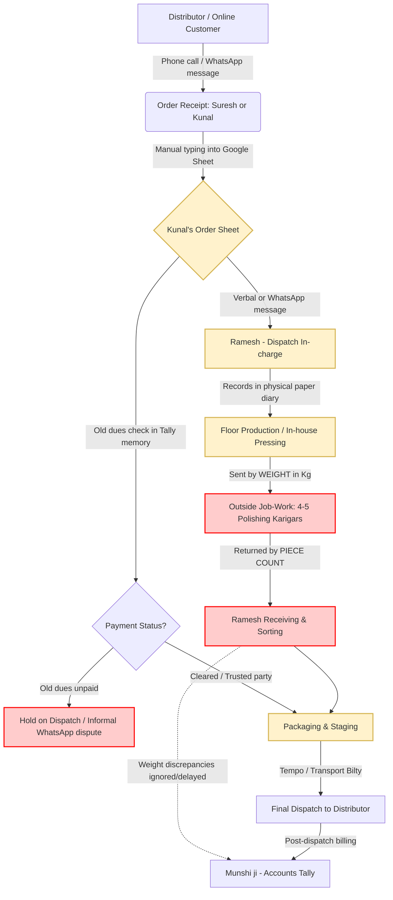
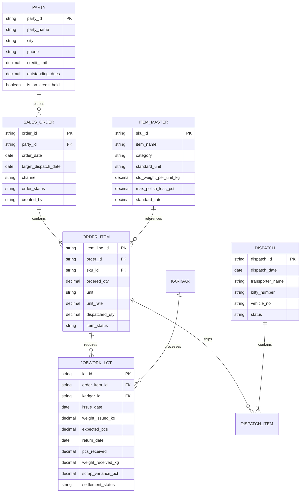

# Part B — Software Requirements Specification (SRS)
## Client: Vardhan Steelware (Jagadhri, Haryana)
**Document Version:** 1.0 (Phase 1 Engineering Build Spec)  
**Target Audience:** Product Engineering, Implementation Leads, Solutions Architects  
**Author:** Solutions Consulting Team

---

### 1. The Problem in the Client's Words
The factory owner is blind to daily operations, hostage to one employee's physical memory, and terrified of another costly software failure before the peak festive rush:

> *"Problem orders ki nahi hai. Problem yeh hai ki pata nahi chalta maal kahan atka hai. Customer phone karta hai toh mujhe Ramesh ko phone karna padta hai. Ramesh ki diary mein sab hai... Mujhe bas phone pe dekhna hai kaunsa order kahan hai. Pehle wale mein paisa doob gaya [₹1.2L ERP]. Jo kaam kare uska de denge. Diwali se pehle chahiye, season hai."* — **Suresh Vardhan (Owner)**

Meanwhile, next-generation leadership seeks cosmetic tech detached from floor realities:
> *"What we really need is a proper modern system. Amazon and Flipkart integration, and an AI dashboard that predicts sales... And it should look modern. I want to show it to our distributors."* — **Kunal Vardhan (Son, MBA)**

---

### 2. What the Material Shows: Quantitative Audit & Data Truth
A line-by-line audit of Kunal’s Google Sheet (1–7 Sep 2026, 25 order lines) and the "Vardhan Dispatch" WhatsApp group exposes massive operational fractures and reveals where perception diverges from quantitative fact:

```
+---------------------------------------------------------------------------------------------------+
| METRIC                       | CLIENT PERCEPTION                 | QUANTITATIVE REALITY (DATA)     |
+---------------------------------------------------------------------------------------------------+
| Monthly Order Run-Rate       | Suresh: "60–70 orders/month"      | 107 orders/month (25 orders in  |
|                              | Kunal: "Usse zyada hain"          | 7 days; Kunal is right)         |
+---------------------------------------------------------------------------------------------------+
| Online Revenue Contribution  | Suresh: "5% bhi nahi hai"         | 7.88% of gross value            |
|                              | Kunal: "Growing 30%/mo, need AI"  | (₹46,192 out of ₹5,86,317)      |
+---------------------------------------------------------------------------------------------------+
| Order Pipeline Health        | Suresh: "Simple hai... maal banta | 54.1% of pipeline value is      |
|                              | hai, pack karke bhej dete hain"   | blocked, pending, or on hold!   |
+---------------------------------------------------------------------------------------------------+
| Job-work Metal Leakage       | Suresh: "Arre, woh wastage hai"   | 3–4% annual metal shrinkage =   |
|                              | (Tolerated as minor slippage)     | ₹1.05L–₹1.40L/month cash bleed! |
+---------------------------------------------------------------------------------------------------+
```

#### Detailed Findings from Order Sheet & WhatsApp Logs:
1. **The Polishing Chokepoint (Single Point of Failure):**
   - Out of 25 order rows, **only 12 orders (45.9% of value, ₹2,68,917)** were successfully dispatched.
   - **9 orders (₹2,37,200 = 40.5% of value)** sit in `pending`/`pend` status.
   - Crucially, **6 of the 9 pending orders are stalled at outside polishing karigars** (Bansal Tope No. 6, New Delhi Steel Bhagona 8L, Gupta Bhagona 8L, Mehra Kadai). 
   - Polishing is completely unmonitored: Ramesh asks on WhatsApp (*"Bhagona sheet mein do jagah likha hai? Gupta ka 40 aur New Delhi ka 60, dono polish mein hain na"*). Nobody knows what is at which karigar.
2. **Severe Metal Bleed in Job-Work ("Tol ke jaata hai, gin ke aata hai"):**
   - WhatsApp message (03/09): Munshi ji logs: *"Karigar Pappu ko 420 kg diya tha, 1180 pcs aaye... Pappu ka 6 kg short. Next lot mein adjust."*
   - A 6 kg shortage on 420 kg is a **1.43% unexplained metal loss on a single batch**.
   - Kunal confirms: *"Last year's audit showed about 3–4% difference in steel."* At Vardhan's throughput (~15–20 tonnes/month of SS 304/200 series utensil steel @ ₹180–220/kg), a 3.5% unrecovered loss is **₹1,05,000 to ₹1,40,000 flushed down the drain every month** (₹15L+ annually). Because metal is issued by weight (kg) but received by piece count (pcs) without standard tare weights, karigars pocket raw steel undetected.
3. **Ghost Orders & Incomplete Data Entries:**
   - **Row 9 (3 Sep):** Dispatched `20 dozen Thali 12 inch` (@ ₹600 = ₹12,000) with a **completely blank party name**! ₹12,000 worth of stock left the premises without a customer or invoice attached.
   - **Row 21 (06-09-26):** `Verma Utensils Sonipat, Kadhai 10 no., 180 kg` — entered in **kg** (all other Kadais are entered in pcs), with **rate left blank** (*"rate confirm karna hai"*).
4. **Duplicate Entries & Order Confusion:**
   - **Gupta Traders Ambala (01-09-26):** Logged twice for 200 pcs Kadai No. 10 (one marked dispatched, one marked pending with remark *"repeat msg?"*).
   - **Jain Crockery Panipat (04-09-26):** 150 pcs Kadai logged again (*"again sent on whatsapp"*).
   - **Bansal & Sons Rohtak (3 Sep vs 5 Sep vs 7 Sep):** 120 pcs Tope No. 6 logged on 3 Sep, logged again on 5 Sep (*"polish se aana baaki"*), and a fresh 60 pcs logged on 7 Sep (*"naya order"*).
5. **Partial Dispatches Disconnected from Parent Orders:**
   - **Mehra Kitchenware (04-09-26):** Order for 300 pcs Kadai. Ramesh ships 180 pcs; 120 pcs remaining logged as a completely new disconnected row on 06-09-26 (*"baaki wala"*). Order fulfillment rates cannot be tracked.
6. **Credit Policy vs. Dispatch Friction:**
   - **Sharma Bartan (Karnal):** Has ₹1.8L old dues. Kunal flags *"hold - payment"*. Yet Sharma messages the dispatch group directly on 05/09 demanding goods for Diwali. Ramesh asks if it's on hold; Kunal has no authority and replies *"Papa se pucho"*. Meanwhile, a return of 6 dozen dented glasses (-₹1,560) is logged without inspection.

---

### 3. As-Is Process Map


#### Process Stage Breakdown & Touchpoints:
1. **Intake:** Orders land on Suresh's personal phone or Kunal’s WhatsApp. No standardized SKU naming (e.g., `Kadai No.10`, `Kadhai No 10`, `Kadhai 10 no.` all coexist).
2. **Credit Vetting:** Munshi ji checks Tally or Suresh recalls payment dues. No hard block: orders enter production even when payments are blocked, tying up working capital.
3. **Floor Orchestration:** Ramesh relies solely on his pocket diary. He has no visibility into what Kunal has promised distributors.
4. **Job-Work (Polishing):** Sent out in lots by gross weight (kg). Karigars return utensils in batches by piece count. Reconciliation happens days later on paper slips; shortages are casually rolled into the *"next lot"*.
5. **Dispatch:** Partial shipments are packed without packing slips. Invoices are cut in Tally hours or days after the vehicle leaves the gate.

---

### 4. Phase 1 Scope: The "Diwali Rush" Release
**Guiding Principle:** Must go live within **3 weeks** (before Diwali peak). Must run on Ramesh’s 5.5-inch smartphone with zero computer literacy required.

```
+---------------------------------------------------------------------------------------------------+
| IN SCOPE (PHASE 1 - MUST DELIVER)        | EXPLICITLY OUT OF SCOPE (PHASE 2 / POST-DIWALI)        |
+---------------------------------------------------------------------------------------------------+
| 1. WhatsApp-to-Order Form / Mobile Entry | 1. Amazon / Flipkart API Direct Integrations           |
|    Standardized SKU master, party auto-  |    (Online is <8% of revenue; manual CSV export is     |
|    complete, duplicate-order warning.    |    sufficient for Phase 1. High dev effort, zero ROI). |
+---------------------------------------------------------------------------------------------------+
| 2. Floor Status Board for Ramesh         | 2. AI Predictive Sales / Demand Forecasting            |
|    3-tap status update on mobile:        |    (Historical data is polluted and chaotic; AI will   |
|    [In Making] -> [At Polish] ->         |    produce garbage. Premature optimization).           |
|    [Ready to Pack] -> [Dispatched].      |                                                        |
+---------------------------------------------------------------------------------------------------+
| 3. Karigar Job-Work Reconciliation       | 3. Full Accounting / Tally Replacement                 |
|    Input: Kg issued. Output: Pcs + Kg    |    (Do NOT touch Munshi ji's core Tally workflow.      |
|    returned. Auto-flags metal variance   |    Provide simple 1-click CSV/XML export to Tally).    |
|    exceeding 1.5% scrap tolerance.       |                                                        |
+---------------------------------------------------------------------------------------------------+
| 4. Credit Gate (Hold / Release Flag)     | 4. Distributor Self-Service Mobile App                 |
|    Munshi/Suresh marks "Payment Hold".   |    (Distributors will not install a new app before     |
|    Ramesh's phone shows red LOCK icon;   |    Diwali. Communication remains on WhatsApp).         |
|    cannot generate dispatch challan.     |                                                        |
+---------------------------------------------------------------------------------------------------+
| 5. Daily Owner WhatsApp Snapshot         | 5. Multi-warehouse / Barcode Scanning Infrastructure   |
|    Morning automated 8:00 AM summary     |    (Requires hardware, scanners, thermal printers;     |
|    to Suresh: Stuck orders & dispatches. |    guaranteed adoption failure on a busy floor).       |
+---------------------------------------------------------------------------------------------------+
```

---

### 5. Data Model & Architecture
A lean, relational relational schema designed for lightning-fast mobile queries:



---

### 6. User Personas & Mobile Interface Design
Every screen is optimized for dirty hands, single-thumb tapping, and vernacular comprehension:

```
+----------------------------------------------------------------------------------------------------+
| USER / ROLE        | WHAT THEY SEE ON THEIR PHONE            | WHAT THEY DO (MAX 2 TAPS)           |
+----------------------------------------------------------------------------------------------------+
| Suresh Vardhan     | "MALIK SNAPSHOT"                        | 1. Tap green button to release      |
| (58, Owner)        | - Big Cards: Dispatched Today (₹),      |    credit hold on trusted party.    |
|                    |   Stuck in Polish (Days), Cash on Hold. | 2. Tap WhatsApp icon next to delayed|
|                    | - Red-flagged list of orders >48h old.  |    lot to auto-nudge Ramesh/Karigar.|
+----------------------------------------------------------------------------------------------------+
| Ramesh             | "RAMESH DISPATCH KHATA" (Hindi UI)      | 1. Tap order card -> Tap "Polish    |
| (Dispatch Head,    | - Filter tabs: [Banana Hai] [Polish]    |    Bhejo" or "Ready for Gaadi".     |
| 22 yrs on floor)   |   [Gaadi Mein Load] [Bhej Diya].        | 2. Big "+ Challan" button to record |
|                    | - Bold Red "HOLD" stamp if unpaid.      |    transport bilty number via audio.|
+----------------------------------------------------------------------------------------------------+
| Munshi ji          | "ACCOUNTS & CREDITS"                    | 1. Toggle switch [Payment Clear /   |
| (Accounts /        | - Party ledger balance vs credit limit. |    Hold] next to distributor name.  |
| Tally Master)      | - Job-work shortfall alert screen       | 2. Tap "Export to Tally" to generate|
|                    |   (e.g., "Pappu: -6 kg short").         |    daily dispatch daybook.          |
+----------------------------------------------------------------------------------------------------+
| Kunal Vardhan      | "ORDER DESK" (Web / Mobile)             | 1. Punch orders with type-ahead SKU |
| (Son, Operations)  | - Real-time order pipeline view.        |    search and duplicate detection.  |
|                    | - Price & unit validation engine.       | 2. Upload online order bulk CSV.    |
+----------------------------------------------------------------------------------------------------+
| Karigars           | ZERO APP DOWNLOAD                       | 1. Receives automated WhatsApp      |
| (Outside Polish)   | Automated WhatsApp text challan in      |    challan with weight & date.      |
|                    | Hindi upon metal issue and receipt.     | 2. Confirms receipt via reply text. |
+----------------------------------------------------------------------------------------------------+
```

---

### 7. Three Reports Suresh Will Open Every Morning (8:00 AM)

#### Report 1: The "Atka Maal" Bottleneck Monitor (Where is production stalled?)
- **Purpose:** Identifies every order stalled beyond 48 hours without needing to call Ramesh.
- **Fields Displayed:** Distributor Name | Item & Quantity | Stalled Location (e.g., *Karigar Pappu - 3 days*) | Promise Date | Delay Severity (Amber/Red).
- **Direct Action:** 1-tap call button to karigar or internal floor lead.

#### Report 2: Karigar Metal Loss & Shrinkage Audit (Anti-Theft Radar)
- **Purpose:** Stops the ₹1.2L/month untracked steel bleed.
- **Fields Displayed:** Karigar Name | Issued Metal (Kg) | Returned Goods (Kg + Pcs) | Theoretical Std Weight | Scrap Variance (Kg & %) | Financial Loss (₹).
- **Direct Action:** Any lot exceeding 1.5% variance is automatically flagged for debit deduction from the karigar's job-work bill.

#### Report 3: Dispatch Pipeline vs. Payment Security
- **Purpose:** Ensures high-value dispatches leave on time while blocking default risks.
- **Fields Displayed:** Value Ready for Dispatch (₹) | Outstanding Dues per Party | Overdue Ageing (>30/60 days) | Status (Released / Blocked).
- **Direct Action:** Suresh can override a payment hold with a biometric thumbprint/PIN right from his morning tea table.

---

### 8. Stakeholder Questionnaire for Next Technical Call

#### For Suresh Vardhan (Owner):
1. *"Diwali season ke liye aapki absolute last dispatch cut-off date kya hai?"* (To baseline SLA hard deadlines).
2. *"Polishing mein kitna percent metal loss aap officially manzoor karte hain (1% ya 2%) jiske upar karigar ka bill katega?"* (To set database validation rules).
3. *"Sharma Bartan jaise purane parties ke liye agar 1.5 lakh se upar dues hain, toh kya partial dispatch allow karna hai ya 100% stop?"* (To define credit gate logic).

#### For Ramesh (Dispatch In-Charge — Floor):
4. *"Ramesh bhai, aapki diary mein jab ek order thoda bhejte hain aur thoda reh jata hai (jaise Mehra ka 180 bhej diya, 120 bacha), toh aap diary mein kaise likhte hain?"* (To model partial-dispatch UX).
5. *"Karkhane mein aap Hindi mein padhna pasand karenge ya English mein? Phone pe bol kar entry karna asaan hoga?"* (To finalize localization and voice-to-text requirements).
6. *"Karigar ko maal dete waqt aur wapas lete waqt kante (weighing scale) pe kaun rehta hai?"* (To identify who captures tare weights).

#### For Munshi ji (Accounts):
7. *"Aap Tally ka kaunsa version chala rahe hain (ERP 9 ya Tally Prime), aur kya inventory Tally mein maintain karte hain ya sirf accounting?"* (To architect Tally sync XML/Excel template).
8. *"Karigar Pappu ka jo 6 kg short aaya, uska paisa aap uske agle bill se kaat-te hain ya raw material loss mein book karte hain?"* (To map credit/debit adjustment flow).

#### For Kunal (Operations & Growth):
9. *"Online Amazon/Flipkart ke orders ka stock kya floor ke aam stock se alag rakha jata hai ya wahi se pack hota hai?"* (To determine inventory allocation logic).
10. *"Verma Utensils ka order aapne 'kg' mein likha jabki baaki sab 'pieces' mein hain—kya kuch distributors weight ke hisaab se payment karte hain?"* (To define dual-unit UOM conversion).

---

### 9. Primary Project Risk & Mitigation Strategy
- **The Existential Risk:** **Floor Adoption Boycott (The "2023 ERP Ghost").**  
  Ramesh has 22 years of tenure, holds supreme informal power, and survived the 2023 ERP failure by simply ignoring it. If the new tool requires complex navigation, multiple form fields, or English prompts, Ramesh will pocket his phone, pull out his paper diary, and the system will be dead in 14 days.
- **The Mitigation Blueprint:**
  1. **Zero-Data-Entry Floor UI:** Ramesh never types text. Statuses are moved using large, color-coded touch cards with vernacular text (*"Polish Bhejo"*, *"Gaadi Mein Chada"*).
  2. **Dedicated Implementation Shadowing:** A Wantace solutions specialist sits on the Jagadhri shop floor beside Ramesh for the first 5 days, shadowing his diary entries and handling all onboarding in person.
  3. **Immediate "What's In It For Me" (WIIFM) for Ramesh:** The moment the system goes live, Suresh stops calling Ramesh 15 times a day asking *"maal kahan hai"*. Once Ramesh realizes the phone app protects him from owner nagging, he becomes its fiercest champion.
