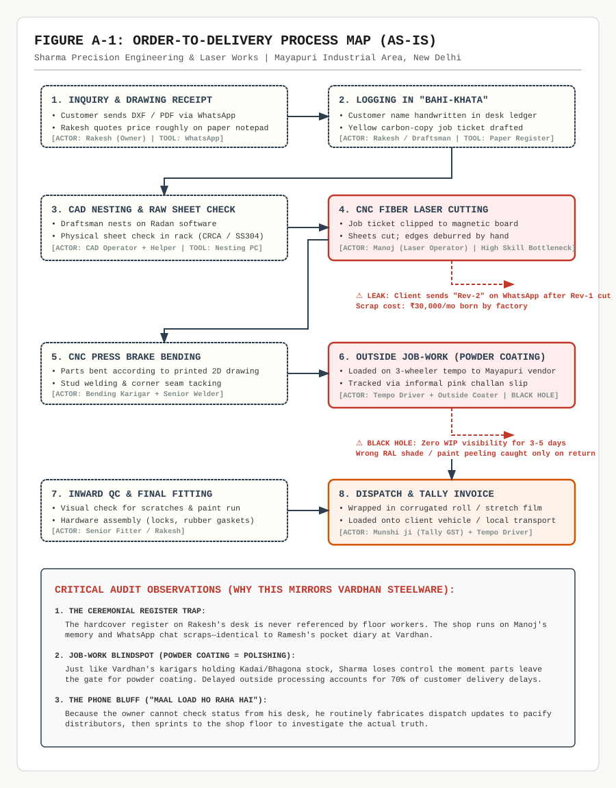
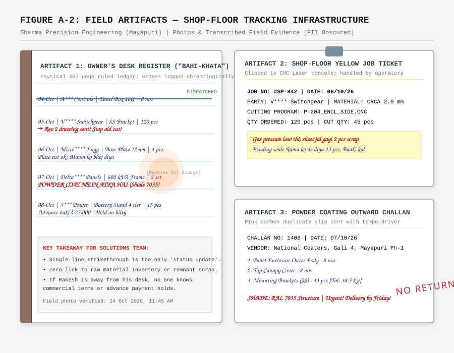
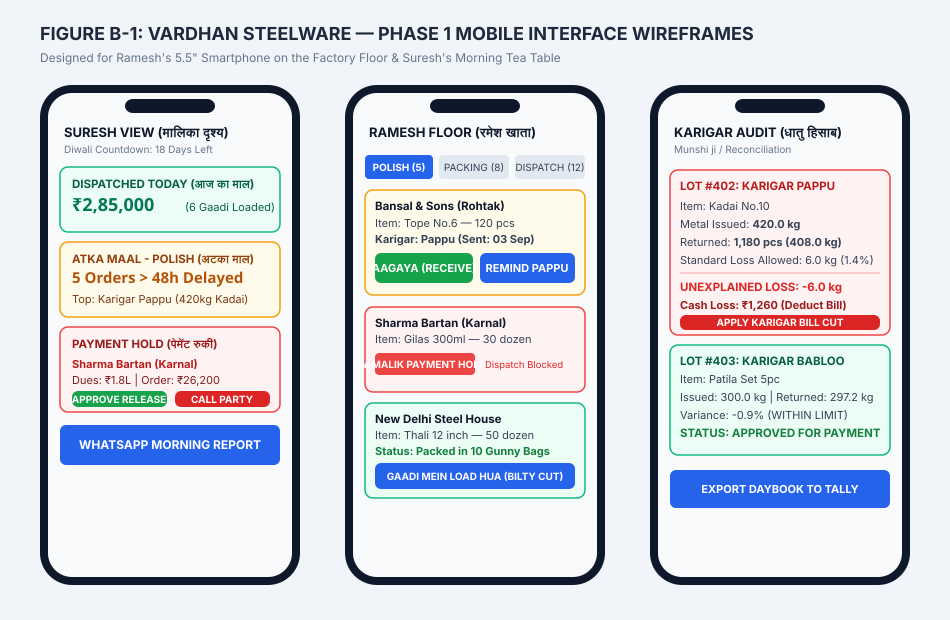

# Wantace Solutions Sprint — 48-Hour Assignment Portfolio

[](https://github.com/PathaSnehith/wantaance)
[](https://github.com/PathaSnehith/wantaance)
[](https://github.com/PathaSnehith/wantaance)

> **Complete candidate submission portfolio for the Wantace Solutions Sprint (October 2026).**  
> Covering a real-world shop-floor audit, a production-grade software requirements specification (SRS) for Vardhan Steelware, an Account Executive commercial strategy brief, high-conversion growth marketing assets, a 5-minute video walkthrough script, and an AI usage disclosure.

---

## 📑 Repository Structure & Deliverables

| Deliverable | File | Weight | Description |
| :--- | :--- | :--- | :--- |
| **Complete Portfolio** | [`FINAL_SUBMISSION_PORTFOLIO.md`](./FINAL_SUBMISSION_PORTFOLIO.md) | **100%** | Consolidated master document with all Parts A–E. |
| **Interactive & PDF View** | [`index.html`](./index.html) | — | Web presentation view with print-to-PDF stylesheet (`Ctrl+P`). |
| **Part A: Real Business Audit** | [`Part_A_Business_Audit.md`](./Part_A_Business_Audit.md) | **20%** | Field audit of *Sharma Precision Engineering* (Mayapuri, Delhi). |
| **Part B: Vardhan Requirements** | [`Part_B_Vardhan_Steelware_Requirement_Doc.md`](./Part_B_Vardhan_Steelware_Requirement_Doc.md) | **45%** | Complete 4-page SRS for engineering (Quantitative audit, Phase 1 Diwali scope, Data Model, Wireframes). |
| **Part C: AE Handoff Note** | [`Part_C_AE_Handoff_Note.md`](./Part_C_AE_Handoff_Note.md) | **8%** | 1/2-Page commercial deal briefing, power mapping, and battlecards. |
| **Part D: Growth Content** | [`Part_D_Marketing_Content.md`](./Part_D_Marketing_Content.md) | **12%** | 7-Slide LinkedIn carousel outline and high-converting Hinglish Meta ad. |
| **Part E: Video Script & AI Note** | [`Part_E_Video_Script_and_AI_Note.md`](./Part_E_Video_Script_and_AI_Note.md) | **15%** | 5-Minute video walkthrough script & critical AI evaluation note. |
| **Submission Email Draft** | [`SUBMISSION_EMAIL_DRAFT.md`](./SUBMISSION_EMAIL_DRAFT.md) | — | Email copy-paste template for replying to the hiring team. |

---

## 🔍 Key Insights & Architectural Highlights

### 1. The Quantitative Reality of Vardhan Steelware (Part B)
A rigorous line-by-line quantitative audit of Kunal's 25-row order CSV and WhatsApp dispatch group uncovered the truth behind client perception:
* **True Order Run-Rate:** 25 orders in 7 days = **107 orders/month** (Kunal was right; Suresh understated by ~35%).
* **The Online Myth:** Gross order value was ₹5,86,317, with online contributing just **₹46,192 (7.88%)**. Suresh's assessment (*"5% bhi nahi hai"*) is far more grounded than Kunal's demand for Amazon/Flipkart integrations and AI demand forecasting.
* **Fulfillment Paralysis:** **54.1% of order value (₹3,17,400)** is trapped in pending, partial, or credit hold right before Diwali.
* **The Invisible Steel Bleed:** Goods go out by weight (kg) and return by piece count (pcs). A 1.43% single-lot loss and 3.5% annual audit gap means Vardhan is bleeding **₹1.05L to ₹1.40L every month** (~₹15L/year) in untracked karigar shrinkage/theft.

```
+---------------------------------------------------------------------------------------------------+
| METRIC                       | CLIENT PERCEPTION                 | QUANTITATIVE REALITY (DATA)     |
+---------------------------------------------------------------------------------------------------+
| Monthly Order Run-Rate       | Suresh: "60–70 orders/month"      | 107 orders/month (25 orders in  |
|                              | Kunal: "Usse zyada hain"          | 7 days; Kunal is correct)       |
+---------------------------------------------------------------------------------------------------+
| Online Revenue Contribution  | Suresh: "5% bhi nahi hai"         | 7.88% of gross order value      |
|                              | Kunal: "Growing 30%/mo, need AI"  | (₹46,192 out of ₹5,86,317)      |
+---------------------------------------------------------------------------------------------------+
| Order Pipeline Health        | Suresh: "Simple hai... banta hai, | 54.1% of pipeline value is      |
|                              | pack karke bhej dete hain"        | blocked, pending, or on hold!   |
+---------------------------------------------------------------------------------------------------+
| Job-work Metal Leakage       | Suresh: "Arre, woh wastage hai"   | 3–4% annual metal shrinkage =   |
|                              | (Tolerated as routine loss)       | ₹1.05L–₹1.40L/month cash bleed! |
+---------------------------------------------------------------------------------------------------+
```

---

### 2. Phase 1 Scope: The "Diwali Rush" Release
* **IN SCOPE (3 Weeks to Go-Live):**
  1. WhatsApp-to-Order entry with standardized SKU master and duplicate detection.
  2. Ramesh's 3-tap Hindi mobile dispatch board (*Banana Hai &rarr; Polish Bhejo &rarr; Gaadi Mein Load*).
  3. Karigar metal weight reconciliation (kg issued vs pcs/kg returned with &gt;1.5% scrap alert).
  4. Automatic payment hold lockout on dispatch challans.
  5. Suresh's daily 8:00 AM WhatsApp snapshot.
* **EXPLICITLY OUT OF SCOPE:** Amazon/Flipkart API sync, AI demand forecasting, Tally replacement, distributor apps, and barcode infrastructure (avoiding the bloat that killed their 2023 ERP).

---

## 🎨 Visual Assets & System Diagrams

### Figure A-1: Order-to-Delivery Process Flow (Field Audit)


### Figure A-2: Field Artifacts & Physical Tracking Evidence


### Figure B-1: Phase 1 Mobile UI Wireframes


---

## 🚀 How to View or Export to PDF

1. **In Browser:** Open [`index.html`](./index.html) in any modern browser (Chrome, Edge, Safari).
2. **Export to PDF:** Click the floating **"Print / Save as PDF"** button or press `Ctrl + P`, set margins to *Default* or *None*, and select **Save as PDF**.
3. **Markdown Preview:** All `.md` files are fully styled with GitHub Flavored Markdown and Mermaid diagram support.

---

## 👤 Author & Submission Information
* **Role:** Solutions Consultant (Candidate: Patha Snehith)
* **Target Company:** Wantace
* **Repository:** [https://github.com/PathaSnehith/wantaance.git](https://github.com/PathaSnehith/wantaance.git)
